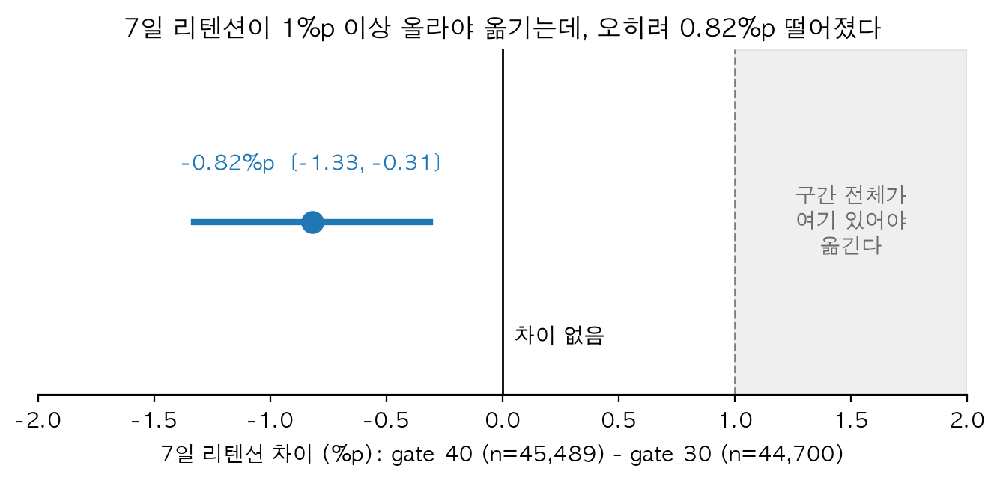

# Cookie Cats A/B 테스트: 첫 관문을 레벨 40으로 옮겨도 되는가

모바일 퍼즐 게임 Cookie Cats의 공개 A/B 테스트 데이터(사용자 90,189명)를 분석했다. 결과를 보기 전에 결정 규칙을 먼저 작성하고, 그 규칙에 결과를 대어 권고를 냈다.

## 질문

Cookie Cats에서는 특정 레벨에 이르면 관문을 만나고, 일정 시간을 기다리거나 결제를 해야 다음으로 갈 수 있다. 사용자는 설치할 때 첫 관문이 레벨 30인 그룹(`gate_30`, 기존)과 레벨 40인 그룹(`gate_40`, 변경)에 무작위로 배정됐다.

**첫 관문을 레벨 30에서 40으로 옮기면 7일 리텐션이 옮길 가치가 있을 만큼 오르는가.**

## 결과

1. **리텐션 기준으로는 레벨 30에 그대로 둔다.** 7일 리텐션은 `gate_30` 19.02%, `gate_40` 18.20%로, 옮긴 쪽이 0.82%p 낮다(95% 신뢰구간 [-1.33%p, -0.31%p]). 미리 정한 기준은 "1%p 이상 오르는 것이 확실하면 옮긴다"였다.
2. **7일째에 돌아오는 사용자가 기존 대비 약 4.3% 줄어드는 크기다.** 다만 신뢰구간이 -1%p 선을 걸치므로 하락이 1%p를 넘는지는 불확실하다.
3. **매출 데이터가 없어 리텐션만 본 권고다.** 옮겼을 때 7일째 남은 사용자 1인당 매출이 약 4.5%(신뢰구간 반영 시 1.7%~7.5%) 넘게 늘어난다면 리텐션 손실을 상쇄한다. 매출이 7일째 남은 사용자 수에 비례한다고 가정한 계산이다.



## 분석에서 지킨 것

- **결정 규칙을 먼저 작성했다.** 주 지표, 판단 기준, 유의수준을 그룹별 결과를 보기 전에 정했다. 그 전에 본 것은 그룹을 나누지 않은 전체 값뿐이다.
- **사용자를 걸러내지 않았다.** 플레이 수는 관문 위치의 영향을 받는 값이라, 이것으로 사용자를 빼면 무작위 배정이 깨진다. 90,189명 전원을 분석했다.
- **표본 비율 점검(SRM)의 기준과 걸렸을 때의 행동을 미리 정했다.** 기준(p < 0.01)에 걸렸고(p = 0.0086), 정해 둔 대로 분석은 계속하되 결론의 확신을 낮췄다.
- **지표를 결과를 보고 고르지 않았다.** 주 지표는 7일 리텐션 하나다. 보조 지표 두 개는 본페로니 보정으로 유의수준 0.025를 적용했다.
- **공식으로 구한 신뢰구간을 부트스트랩으로 다시 확인했다.** 두 구간이 거의 같다([-1.34%p, -0.32%p]).

## 한계

- **SRM이 의심된다.** 배정과 수집 과정을 확인할 수 없어 원인을 모른다. 결론을 가장 크게 흔들 수 있는 한계다.
- **매출 데이터가 없다.** 관문은 결제가 일어나는 지점이라, 매출까지 보면 결론이 달라질 수 있다.
- **누가 관문을 만났는지 알 수 없다.** 판 수만 있고 도달 레벨이 없다. 사용자의 최소 63%는 관문을 만나지 않았으므로 전체로 구한 차이는 희석된 값이다.
- **점검용 지표가 깨끗하지 않다.** 1일 리텐션은 유의하지 않았지만 신뢰구간이 넓어 1%p가 넘는 하락도 배제하지 못한다.
- **판단 기준 1%p는 가정이다.** 사업 정보가 없어 가정으로 정했다. 결과가 하락이라 이 선을 다르게 잡아도 권고는 같다.

## 실행 방법

```bash
python3 -m venv .venv
source .venv/bin/activate
pip install -r requirements.txt
```

VS Code나 Jupyter에서 `analysis.ipynb`를 열고 `.venv` 커널로 전체 실행한다. 차트의 한글 폰트는 macOS의 AppleGothic으로 설정돼 있다. 다른 운영체제에서는 첫 코드 셀의 폰트 이름을 바꿔야 한다.

## 데이터

Kaggle "Mobile Games A/B Testing - Cookie Cats". `data/cookie_cats.csv`에 들어 있다. 실험 기간과 날짜, 배정 방식의 세부, 매출은 공개되지 않았다.
